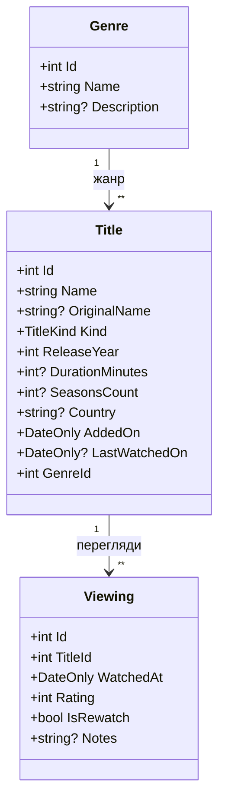

# MovieVault

Вебзастосунок для обліку переглянутих фільмів і серіалів.

Користувач веде каталог творів, позначає їхні жанри та фіксує кожен
перегляд, а за цими записами отримує зведення про власні уподобання
(улюблені жанри, середні оцінки) та активність (скільки переглядів
за період).

**Тема:** Каталог фільмів і серіалів: твори, жанри, перегляди;
уподобання та активність.

**Призначення:** для однієї людини, яка хоче впорядкувати власну
колекцію переглянутого й побачити, що вона насправді любить дивитися.

## Технології

- .NET 10, ASP.NET Core Blazor Web App (статичне відтворення на сервері)
- Entity Framework Core, SQLite
- xUnit (модульні тести)

## Особливість проєкту

**Пошук за кількома умовами зі збереженням обраного фільтра між сеансами.**

На сторінці каталогу користувач зможе звузити список творів одночасно
за кількома ознаками: жанр, вид (фільм чи серіал), рік випуску, оцінка,
країна. Обраний набір умов зберігатиметься й відновлюватиметься під
час наступного відкриття сторінки — щоб не вводити його щоразу заново.

## Запуск

Інструкцію буде доповнено в наступних роботах.

## Модель даних

